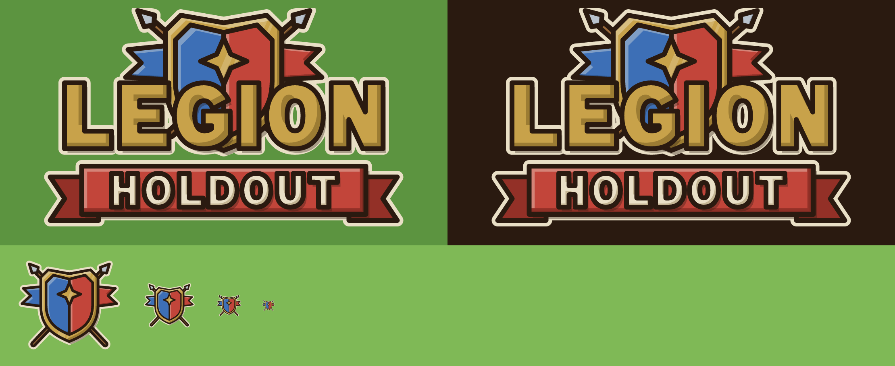

# Legion Battles



A 2D fantasy autobattler for the browser. You open packs to get cards, field a team of them, and battles start by themselves: your units fight on their own, a win moves you on to the next stage, and you step in to change the team, open packs or go into a dungeon.

Everything on screen is drawn in code as SVG. The sounds and the music are played on recorded instruments and drums from two public-domain libraries, cut down to one small file. There are no bought assets and nothing is fetched from the network when the game runs.

## Run it

```bash
npm install
```

```bash
npm run dev
```

Then open http://127.0.0.1:5173/. Add `?seed=123` to go straight to a skirmish with that seed.

| Command | What it does |
| --- | --- |
| `npm run dev` | The game, with reload on change. |
| `npm run build` | Type check, then build to `dist/`. Paths are relative, so `dist/` runs from any subfolder. The build is 4.5 MB, of which the recorded sounds are under half a megabyte. |
| `npm test` | Every test: the simulation, the rules, the data, the line of stages, dungeons and raids, the rewards, the tutorials, the sheets, the bank of recorded sounds, the effects and the music, the build's pictures. |
| `npm run art` | Writes every picture as SVG under `public/assets`, and the manifest. |
| `npm run art:sheet` | The same, then draws the contact sheets into `docs/art` and checks colors and line widths. |
| `npm run balance` | Plays 400 skirmishes and says how long they last and who wins. |
| `npm run journey` | Plays new players along the line of stages and says where they stall. |
| `npm run listen` | Writes the music and every effect to sound files in `build/listen`, and prints how loud each is. Needs the dev server running. |
| `npm run samples` | Cuts the bank of recorded sounds again from the two libraries it is made of. Only to change what is in it: see "Remaking the bank of sounds". |

Thirteen scripts play the game in a headless browser. They need the dev server running, and Playwright. Their pictures go to `docs/screens`.

```bash
node scripts/newplayer.mjs
```

```bash
node scripts/tour.mjs
```

```bash
node scripts/venture.mjs
```

```bash
node scripts/structures.mjs
```

```bash
node scripts/fields.mjs
```

```bash
node scripts/player.mjs
```

```bash
node scripts/rewards.mjs
```

```bash
node scripts/tours.mjs
```

```bash
node scripts/settings.mjs
```

```bash
node scripts/listen.mjs
```

```bash
node scripts/screens.mjs
```

```bash
node scripts/touch.mjs
```

```bash
node scripts/perf.mjs
```

`newplayer.mjs` starts from an empty save, watches the first battle start by itself and presses whatever the tutorial points at until it is over, then lets battles run and presses through whatever tour comes up between them; with `TOUCH=1` in front it does that on a phone held sideways, with touches only. `tour.mjs` loads a save that is well into the game and visits the map, the units, the forge, the index, the packs and two bosses. `venture.mjs` walks a dungeon floor by floor from the hall of dungeons, and then a raid from the hall of raids. `structures.mjs` stands towers, a barracks and traps on both sides and looks at them in a battle, on the side screens that UNITS and STRUCTURES open, on the INDEX, and in the shop. `fields.mjs` shows a stage on each of the three fields, with a summoner on two of them. `player.mjs` shows the loading screen with the logo, the level under the coins, the skill tree, the upgrades, and the result of a boss's first fall. `rewards.mjs` claims a day of the calendar, comes back tomorrow for the card of the second day, plays twelve minutes in a moment and claims the pack no shop sells. `tours.mjs` lets every tour start by itself and presses through each, opens the settings and views one again, and then, for a player whose first raid has opened, walks the raids' own tour; it fails if a step points at nothing or does not move on, or if the dungeons' tour points at a raid. `settings.mjs` presses everything on the settings screen and checks that each press does what it says and is kept: the volumes, sound off and on, the three ways of drawing (on a dense screen, so that the canvas changes size), screen shake, and START OVER, which must ask first and keep the settings. `listen.mjs` takes no pictures: it writes the music of each land, a crowded battle's effects and every effect by itself to sound files in `build/listen`, and prints how loud each is, played from the bank and made from oscillators. `screens.mjs` and `touch.mjs` walk a skirmish with a mouse and with touches. `perf.mjs` measures a full battle: script time a frame with the processor slowed, draw calls, and where the time goes. The walks share `scripts/walk.mjs`, which presses a button by what it says, or by the name its screen has marked it with for the tutorials, so that moving a button does not break a walk.

## Play it without installing anything

`.github/workflows/pages.yml` builds the game and publishes it to GitHub Pages on every push. It needs one setting, once: in the repository, Settings, Pages, Source: GitHub Actions. The game is then at `https://<owner>.github.io/LegionBattles/`.

## How the game works

**Cards.** A unit is a card. A card has a tier (Common to Legendary), which says how rare it is in its own set, a grade (F to S), which its pack rolls and which never changes, and a level, which it earns. Grade and level multiply its health and damage. A grade is always shown as its badge, which grows grander as grades rise.

**Every card is its own.** A pack always turns over a card, and a copy of a unit you already hold is another card with its own grade and level. You can field it beside the first (a team can have two Knights) or combine it away.

**Combining.** COMBINE, on a card in UNITS, turns the screen into a forge. The card you chose grows, each card you mark is given up, and the panel says what level that makes before COMBINE asks once. Any card can be given up to any other. A copy of the card's own unit gives twice what another unit does, and a better grade, a rarer unit and a higher level give more. A card gives a fifth less than the experience it holds, so passing levels from card to card makes nothing. A card in the team is kept.

**UNITS, STRUCTURES and the INDEX.** UNITS and STRUCTURES are two buttons on the main screen. Each opens a side screen: the cards you hold on the left, and your half of the field on the right with the enemy put away, so a change to the team is seen on the field as it is made. A card's panel says its role beside its tier and its set. SORT steps through unit, power, grade, level, rarity, health and damage. FILL TEAM fields the strongest team with a mix of roles, and the strongest structures. INDEX, on that screen, is the page of every unit there is.

**Structures.** A structure is a building or a trap, and it is a card like any other. A building stands where it is put: a Watchtower shoots whoever comes within its reach, a Barracks sends out Militia, a Palisade stands in the way, a War Banner makes those near it fight faster. Nothing mends a building. A trap lies flat with a ring of its side's color round it, is no one's target, and goes off once under the first enemy to step on it. Structures stand in places of their own beside the team: one from the start, a second from stage 20, a third from stage 37, so a tower takes no fighter's place. The enemy has them too: each land has a tower, a hall that sends its troops out, and a trap, and they stand in its stages. A side has lost when every unit and every building of its own is down, so a tower left standing has to be brought down too. A trap holds nothing.

**Summoners.** A summoner is a unit that fights little and calls others to its side, as strong as it is: the Herald calls Militia, and each land has one of its own (the Ringleader, the War Drummer, the Skald), which stands in a few of its stages. A summoner calls three in a battle and a hall four, so a long fight does not feed itself.

**Packs.** Every pack holds one card. A pack names its set and the grades it can hand out, and holds everything of its set from the start: nothing in it has to be unlocked. A land's pack turns over one of its structures about one time in five. The Recruit Pack holds people only, and the Builder's Pack holds only the Crownlands' structures; both are sold from the start.

**The packs screen.** Every pack has a slot of its own, small, laid out as the cards on UNITS are: the four that are no land's along the top (the last of them the Faithful Pack, which is given and never sold), then a row to a land with a slot to each difficulty. Pressing a slot brings that pack up on the right, big: the grades it hands out, a tile for everything it can turn over (a unit you have not met is its outline in the dark, on no tier's color), and how likely each tier is. Pressing a tile says what it is and how likely. OPEN opens one, and the button beside it opens as many as you hold, up to ten. A pack that is not sold yet says what opens it.

**Opening a pack.** The pouch shakes, a light in the color of the best thing inside gathers behind it, and it bursts. One pack: its card rises out of it and turns over, rays turn behind a Rare or better, and its grade is stamped on a moment after. Several: the cards are dealt face down and turned one after another, the rarest last, and a press turns the rest at once.

**Battles.** Your tiles are the left half of the field. Units walk to the nearest enemy, attack on their own rhythm, and use their skill whenever it is ready. Over each unit is its plate: its level on the color of its tier, its health as a bar with the number on it, and its grade. The plates are up before the battle too, on both sides. A status on a unit is an icon over its plate with motes rising from the unit, and what it takes is a number in the status's own color, so poison is not read as mending. Press an enemy for a card that says what it is, which stays until something else is pressed; press one of your own to open its card in UNITS. A battle is won when every unit and every building of the other side is down. A battle lasts about 20 to 40 seconds.

**The field grows with the stage.** The first world is fought on a field of 8 by 4 tiles, the rest of the first lap on 10 by 5, and every lap after on 12 by 6. The line under the stage's plate says which. Every field is drawn in the same place on the screen: a bigger one has smaller tiles, and everyone on it is drawn smaller. A stage's enemies are written on the first field; on a bigger one they keep their depth behind their front line and are spread over its height. Your team's formation is kept as it would be written on the first field, so it is the same formation on every field, with more room behind and beside it on a bigger one. The first time the line comes to a bigger field, the team forms up again for it. Back on a smaller field (an early stage, a dungeon's first tier), whoever stood beyond it comes in to the nearest free tile for that battle, and the formation you set is not changed.

**Battles start by themselves.** BATTLE counts down two seconds and presses itself. A first win moves on to the next stage. A win at a stage already cleared stays there, so a team left alone earns from a stage it can beat. A loss steps back one stage, and a changed team goes back to the stage it lost at. AUTO stops battles starting by themselves, and STOP gives up the one that is on and opens nothing; the count also waits while a screen is open or a unit is being dragged.

**The line of stages.** There is one line of 185 stages, and a stage's place on it says how hard it is: enemies grow stronger along it, and so do what a win pays, what it teaches and the price of the pack it drops. A world is a land: World 1 is Thornwood, World 2 Sunscar Dunes, World 3 Frostholt. Each land has minibosses and ends in a boss. A stage is shown by its number in its own difficulty, from 1: the line's 38th stage is stage 1 on Hard.

**Difficulties.** Every world has five: Normal, Hard, Expert, Master, Nightmare. The line runs through the three worlds on Normal (its first 37 stages), then through all three on Hard (its next 37), and so on, so every stage of every world on every difficulty has its place on the one scale. A world opens on a difficulty when you have beaten it on the difficulty before, and beaten the world before it on this one. Following the line, each opens in its turn. What the rule adds is that Thornwood on Hard opens as soon as the Warlord falls on Normal, before the other two worlds are beaten: its first stage is the line's 38th, which is how far ahead that is. Stages won ahead of the line are kept, and counted when the line comes to them. Places in the team, places for structures, dungeons and raids open by how far the line itself is cleared, in order.

**The map.** The main screen shows only the stage you are on, under the banner of its world, which says its difficulty on a chip in that difficulty's color. Pressing it opens the map of that world: a painted land with a road from stage to stage, a camp at each, a watchtower where a miniboss waits and a stronghold for the boss. Press an open stage to go there. A row of the five difficulties stands under the heading: an open one turns the map to it, and a shut one says what must be beaten to open it. The arrows turn to the worlds on either side on the same difficulty, if they are open.

**After a battle.** The result says what was won as pictures of the things: the coins, each kind of pack that dropped, the experience. Then the cards that made a level, as the units they are, each with its new level. Then your own level and what the battle added to it. Then whatever the win opened.

**Your level, the skill tree, and upgrades.** A battle teaches you what it teaches each card that fought, won or lost. Each level is a skill point. The tree has four branches from one root: War (harder blows), Guard (more health), Craft (stronger structures) and Fortune (more coins, faster learning, more packs dropped, cheaper packs). It has 51 ranks and a player who walks the whole line earns about 35 points, so it is a choice; every point can be taken back, for nothing. Coins also buy five upgrades, each level dearer than the last: Whetstones, Rations, Seasoned Timber, Ledgers and Tutors. Your level stands under your coins on the main screen, with a red mark when there is a point to spend or an upgrade the coins will pay for, and pressing it opens both.

**The team.** A new player has an Archer, a Knight, a Cleric and a Watchtower: one who shoots, one who stands in front, one who mends, and a structure. There are four places for units from the start and more at stages 5, 10, 22 and 37, up to eight, with up to three structures beside them. A unit dragged to another tile stays there.

**Dungeons.** A dungeon is a run of floors fought one after another with one roster: your team and two reserves. Nothing heals between floors and the fallen stay fallen, so the camp between floors shows what each card has left, and pressing a card sends it in or rests it. A floor lost ends the run. Only clearing the last floor pays: coins and two of the land's pack one lap better than the line is dropping there.

**Raids.** A raid is one long battle against a land's lord, grown huge, who calls up more of his own for as long as he stands. Every win pays, more than a dungeon, and it can be fought again at once.

There is one dungeon and one raid to a land. The dungeons open at stages 10, 22 and 37 and the raids at 22, 37 and 47. Each has the five difficulties too, each opened by clearing the one before. DUNGEONS and RAIDS, at the top left of the main screen, each open a hall of their own; RAIDS is not there until the first raid is open.

**Rewards.** REWARDS, under your level on the main screen, opens two tracks, and the count on it says how many things wait. The daily calendar has seven days: one is claimed each day you come back, by your own clock. It is not a streak, so a day missed loses nothing. Its second day gives the Lamplighter and its seventh the Honor Guard, two cards no pack holds. After the seventh it goes round again, and those two come a grade better each time. The other track is the time played today: 2, 5, 10, 20 and 30 minutes each give something, and ten minutes gives the Faithful Pack, which no shop sells. The time is counted only while the game is on the screen, and it starts again each day, with its rewards. Coins and packs given are sized to where you stand: so many wins' worth of coins, and the pack of the land your line has come to.

**The Faithful.** A set of six that only the rewards give: the Beekeeper, the Gravedigger, the Bell Ringer and the Blacksmith out of the Faithful Pack, and the Lamplighter and the Honor Guard from the calendar. They are townsfolk, not soldiers, sized between the second land's units and the third's. The Faithful Pack has one slot in the shop, dark until you have been given one, and its grades rise with the difficulty your line has come to, as a land's pack's do.

**Tutorials.** A new player is shown the first battle, a pack, the team, the structure and the stage's plate, a line of words at a time, and then the rewards screen. Which step is up is worked out from the save, so a reload in the middle carries on. After it there are tours, a few short notes each: the rewards, the packs, dungeons, raids, skill points and upgrades. A tour starts by itself the first time its part of the game matters (coins enough for a pack or an upgrade, a level made, a dungeon or a raid open, a reward waiting), and never straight after another: two battles are fought between them. A tour ends on the screen it led to, with everything there free to be pressed, and every step has SKIP. The settings list every tour, and any of them can be viewed again there; one you have not come to yet is dark.

**Screens.** A menu opens as a window over the field and leaves a border of the field showing round it, so it is plain what it was opened over. The units screen is a side screen instead, as it changes what stands on the field.

**Settings.** The gear on the main screen. Sound on or off, a volume each for the music and for the effects, how the game is drawn (AUTO picks for the screen and draws plainer if frames come slowly, SHARP keeps the screen's own sharpness, FAST draws plainer), whether the screen shakes when something rare is turned over, the list of tutorials, and START OVER, which asks once and keeps only the settings.

**Music.** Each land has a theme of its own, sixteen bars long, played on recorded instruments: Thornwood a dance on a flute, the Sunscar Dunes a slower tune on an oboe over hand drums, Frostholt a harp with small bells over its long notes. Under each, cellos hold the chord and a bass is plucked. While the team is being set out it is calm. When a battle starts the same bars go on with drums under them and a flute an octave over the tune, and when it ends they fall away again.

**What you have not met is dark.** A unit you have never held or beaten is a black outline named "???". So is a pack that is not sold yet, a pack or a card of the rewards that you have never been given, a dungeon or raid that is not open, and a tutorial for something you have not come to. A stage that is not open is a lock on the map.

**Skirmish.** `?seed=N` in the address plays the first four units against four random enemies. The same seed and the same placement always give the same battle. It is for testing, and no button leads to it.

Press `D` in a battle for the debug overlay: tiles, ranges, targets, frame rate, and how full the art sheet is.

## Where things are

| Folder | What is in it |
| --- | --- |
| `src/sim` | The battle. Pure TypeScript, no Phaser. Fixed 50 ms steps, a seeded generator, events for the view. `field.ts` is the field: its size, and where a team written on the first field stands on a bigger one. |
| `src/data` | The numbers: units (structures, summoners and the Faithful among them), the lands and their stages, the laps, the fields, the line of stages, packs, dungeons and raids, the rewards. |
| `src/game` | The rules around the battles: cards and combining, sorting, packs, progress and which worlds are open, the run of battles, dungeons and raids, the player's level, tree and upgrades, the bonuses those give, the rewards, the tutorials, the save. Pure TypeScript. |
| `src/art` | The art, as code. `kit/` is the palette and the reusable parts, `units/` is one file to a unit, `scenery.ts` and `backdrop.ts` are the painted scenes. |
| `src/audio` | The sounds and the music. `bank.ts` reads the bank of recorded sounds (`public/assets/audio/bank.bin`), `sfx.ts` is the effects and the mix they and the music share, `music.ts` is the themes and what plays them. |
| `src/view` | Phaser: the scenes, the board, the unit rig, effects, the interface. |
| `src/platform` | The ads interface a portal's SDK will plug into. It does nothing yet. |
| `scripts` | Art generation, contact sheets, the bank of sounds, balance and journey reports, browser walks. |
| `tests` | Vitest. |
| `art/overrides` | Hand-edited SVGs that take the place of generated ones. |
| `docs/art`, `docs/screens` | The contact sheets and the screenshots. |

## Tuning

**A unit's numbers** are in `src/data/units.ts`. They are written at the strength of the first set; a set's `power` multiplies them, which is how later lands outdo earlier ones. After a change:

```bash
npm run balance
```

That prints the spread of skirmish lengths (84% fall between 15 and 30 seconds) and a table of every unit against every other.

**A stage** is one line in `src/data/lands.ts`: who stands where, and the grade and level they stand at the first time the line comes through. **The line** is built from the lands in `src/data/stages.ts`: after the first lap, a troop's strength climbs from a step above the first lap's last boss to `TOP` at stage 185, and each stage's grade and level are worked out from that. **A lap** (`src/data/laps.ts`) says the fewest enemies a stage fields and how much of a land's `weight` counts. That count is of what a stage is worth, not of heads: a tent or a summoner counts as the four it calls, a boss as three, a trap as none (`fieldedWorth` in `stages.ts`). **The fields** are in `src/data/fields.ts`, with which world is fought on which. After changing any of these, a pack, what a win pays, or anything a player's growth depends on:

```bash
npm run journey 12 --worlds=15 --losses
```

It plays twelve new players along the line by the game's own rules and prints, for each world, how many battles it took, how many were lost, how long a battle lasts, and how strong the team was when the boss fell. `--losses` lists the stages that beat players most often, which is where the walls are. Without `--worlds` it plays the first three. `--bare` plays players who spend no skill points and buy no upgrades, to see what those are worth. A player who gives up at a wall is named at the end, with the team they stood there with, who held the stage, what they had left to spend and how one more battle there went; `--player=4` plays only that one again, in a few seconds. As last measured on 24 November 2026, after the starting team became an Archer, a Knight, a Cleric and a Watchtower and a battle came to need every building down: twenty-three of twenty-four finish the line, half of them in under about 290 battles, the slowest in 911. One stalled at the Colossus on Expert, which the run before those two changes did not show.

| World | Stages | Field | Battles, half took under | Lost | A battle |
| --- | --- | --- | --- | --- | --- |
| Thornwood, Normal | 1 to 10 | 8 by 4 | 14 | 19% | 23 s |
| Sunscar Dunes, Normal | 11 to 22 | 10 by 5 | 54 | 43% | 26 s |
| Frostholt, Normal | 23 to 37 | 10 by 5 | 35 | 27% | 32 s |
| The three on Hard | 38 to 74 | 12 by 6 | 12, 12, 17 | 28%, 12%, 17% | 32 s |
| The three on Expert | 75 to 111 | 12 by 6 | 15, 12, 17 | 33%, 8%, 12% | 34 s |
| The three on Master | 112 to 148 | 12 by 6 | 10, 12, 15 | 10%, 13%, 2% | 32 s |
| The three on Nightmare | 149 to 185 | 12 by 6 | 10, 12, 15 | 60%, 24%, 17% | 37 s |

The simulated players are plain. They follow the line and never try a difficulty ahead of it. They buy the dearest pack on sale, combine every copy into the best card of its unit and every idle card into their team, and press FILL TEAM. They spend each skill point as it comes, on what makes the team fight better first and on Fortune last, and buy any upgrade that costs no more than the dearest pack on sale. They never arrange their team by hand, so nothing here says what good placement of a tower or a trap is worth. Read what half of them took before the average: one player in twenty-four took 473 battles over Thornwood on Nightmare and one never passed the Colossus on Expert, which are the nearest things to walls, and Frostholt on Master is a soft spot. The stage lost most often is the Long Stair, the tenth of the Sunscar Dunes on Normal: twelve or thirteen times a player. The table's stages are places on the line, not the numbers a player is shown.

**The one who stalled** says something about the second half of the line. Their eight cards were all at the level cap, 20, at grades A and B, so no battle could teach them more, and they had spent every coin on packs and upgrades. Stood before the Colossus on Expert forty times, that team won none; with its three B cards made A it won five, with everything at S all forty, and with a Colossus of their own in a support's place twenty-eight. The other twenty-three lost there once in ten battles. So from about the middle of the line a team grows only by better grades, by the tree and by upgrades, and a player whose packs have not been kind can be held at a boss until one is. A real player has ways out that the simulated ones do not use: a dungeon's or a raid's packs are a lap better than the line's, and a team can be chosen and set out by hand. Whether those are enough has not been tried.

**The line was weighed three times on that day.** Structures, summoners and bigger fields made it shorter in battles than it had been (half of twelve players took under about 730 before them) and its battles longer (they were 20 to 28 seconds). Then the player's own level, tree and upgrades made everything they field about a third stronger by the end, and the last stage of all was raised from 7 to 9 (`TOP` in `stages.ts`) to keep the later difficulties a fight.

**A structure or a summoner in a stage** is strong for what it is. The first tries stood a tent beside each land's boss, and the Colossus then beat simulated players a hundred times each; a tent that called without end made one stage of Thornwood a wall on every later difficulty. So no boss has a hall beside it, every caller has an end to whom it calls (`total` on `summons`), and a difficulty counts a caller as four. Measure after adding one.

**The player's level, the skill tree and the upgrades** are in `src/data/player.ts`: how much experience a level takes, each node of the tree (its effect, what a rank gives, what it needs), each upgrade (what a level gives, what the first costs, how fast the price grows). **Every bonus is added up in one place**, `src/game/bonuses.ts`: a source is one entry in `SOURCES`, and the fights, the pay, the experience, the drops and the price of packs all ask `bonus(save, effect)`. A new source of bonuses is one entry there and nothing else.

**Grades, levels and tiers** are in `src/game/rarity.ts`. **Combining** is in `src/game/cards.ts`. **Team size and drop chance** are in `src/game/rules.ts`. **Packs** are in `src/data/packs.ts`. **Dungeons and raids** are in `src/data/expeditions.ts`, and what they pay at the top of `src/game/expeditions.ts`. Nobody has measured how hard each tier of a dungeon or a raid is for the team a player has when it opens: they stand a little above the land's own boss on that lap, and that is all.

**The rewards** are in `src/data/rewards.ts`: what each day of the calendar gives and what each step of the playtime track gives, at how many minutes. Coins are written as wins' worth and a land's pack as `land`, so neither has to be changed when the line is. The rules are in `src/game/rewards.ts`, and they are told the day and never ask for it, so the tests turn the calendar's pages. In the game, `?days=2` in the address moves the clock two days on, and `addDays(1)` in the console does it while playing.

**The tutorials** are in `src/game/tutorial.ts`. `TOURS` is data: each tour's name, when it starts by itself, and its steps, each a screen, the name of what it points at there, and a line of words. `TOUR_GAP` is how many battles are fought between two of them.

**The music** is in `src/audio/music.ts`: a theme is a scale, a chord for each of sixteen bars, and a tune written in the steps of that scale, eight slots to a bar. A test holds each tune to its chords. **The mix** is at the top of `src/audio/sfx.ts`. How loud an effect is in it is its `level`, and how loud the band is `BAND` in `music.ts`; both were set by measuring. After a change, `npm run listen` writes it all to sound files and prints the levels. As last measured, at the volumes a new player has: the music by itself is 20 to 22 decibels under full scale, a crowded battle over it 16 under with its loudest peak 3 under, and with both volumes all the way up the peak is 2 under. Nothing clips.

## Adding things

**A structure.** A unit with `kind: 'building'` and `still: true`, or `kind: 'trap'` and a `trap` (what sets it off, how wide it strikes, what it leaves). A building can shoot (a `range` and a `projectile`), call troops (`summons`), or keep a status on those near it (`aura`). Its art has a shadow and a body and no weapon (`src/art/units/structures.ts`). A land's own goes into a few of its stages and comes out of its pack. **A summoner** is a unit with `summons`: who it calls, how often, how many at once, and how many in all.

**A field.** An entry in `FIELDS` in `src/data/fields.ts`, as much wider than tall as the others, and a rule in `fieldOfWorld` for which worlds are fought on it. `npm run art` paints its tiles for every kind of land. Nothing else names a field's size: the battle, the rules and the board all take it from the stage.

**A unit.** Add its numbers to `src/data/units.ts` and its art to `src/art/units` (see `ART_GUIDE.md`). Run `npm run art:sheet` and look at the sheets. Run `npm test`: it fails if a unit has numbers and no art, or art and no numbers, or if the sheets the game packs its art onto are full.

**A land.** Add an entry to `LANDS` in `src/data/lands.ts` with a `weight`, a set to `SETS` and its units in `units.ts`, and a pack in `packs.ts` with a look in `src/art/packs.ts`. If its kind of ground is new, add its colors to `src/art/board.ts`, its scenery to `src/art/scenery.ts` and its look to `LOOKS` in `src/art/backdrop.ts`, and an emblem to `src/art/icons.ts`. The line grows by itself: every lap gets the new land's stages. The tests hold a land to the rules: 10 to 25 stages, never fewer than the land before and never more than 5 more; one boss, at the end; a miniboss before it; only its own set's units. Then run the journey report and set the grades, levels and weight by what it says.

**A dungeon or a raid.** An entry in `src/data/expeditions.ts`: its land, the stage it opens at, and its floors written as stages are, or its lord, his guard and who he calls up. The tests go through every floor of every dungeon and every raid.

**A skill.** A skill is data on a unit: a kind (`strike`, `cleave`, `blast`, `volley`, `drain`, `mend`, `boon`, `hex`), a cooldown, and the kind's numbers. A new kind is a case in `useSkill` in `src/sim/battle.ts`, with a test.

**A sound.** A recipe in `src/audio/sfx.ts`: `hits`, the recorded sounds it is played on (which, how loud beside the others, how fast, when), a `level` for the whole of it in the mix, and the tones and bursts of noise it is made of where the bank is missing. One of a battle's small sounds says `crowd`, so that it is dropped when the air is full, and one that repeats says `vary`. The tests play every one both ways, and `npm run listen` says how loud it came out. **A recording** is a line in `scripts/samples.mjs`; a test fails on a sound in the bank that nothing plays.

**A tour.** An entry in `TOURS` in `src/game/tutorial.ts`. It starts on the main screen with a step that is pressed, leads into one screen at the most, and if its last step asks for CLOSE the player is back on the field when it ends. What a step points at must be marked on its screen by that name (`guide.mark('name', ...)`): a test reads the screens' own files and fails on a name that is not there. `node scripts/tours.mjs` then walks it in the game.

**A reward.** A line in `DAILY` or `PLAYTIME` in `src/data/rewards.ts`. A card given by name is a unit with `prize: true`, which keeps it out of every pack.

**A theme.** An entry in `THEMES` in `src/audio/music.ts`, under the name of the kind of ground it is for. Its `voice` says what plays the tune, and its `kit` what each of its drums is struck on. The test fails on a note that lands on a strong beat and is not in the chord under it, and on a note played far from where its instrument was recorded.

## Regenerating art, and editing it by hand

```bash
npm run art
```

writes the logo and its mark (`logo/`), `public/assets/units/<team>/<unit>/<part>.svg` for both teams, a whole-unit `full.svg` for the menus, the effects, the icons, the packs, the grade badges, the painted ground of a battle in each kind of land (`board/`), the tiles of each field on each kind of land (`tiles/`), the map of each land (`maps/`), and `public/assets/manifest.json`, which lists each unit's parts in draw order with their pivots.

To change a picture by hand, copy it to the same path under `art/overrides` and edit it there, in Inkscape or anything else. For example `art/overrides/units/blue/knight/head.svg` replaces `public/assets/units/blue/knight/head.svg`. The dev server serves your file straight away. `npm run art` never writes under `art/overrides`; run it after adding or changing an override so that the manifest measures your file, and a build copies overrides over the generated files.

Every part of a unit is drawn on the same 192 by 192 canvas with the feet at (96, 180), so stacking the parts at one place assembles the unit. A unit's file has 40 px of page round that canvas, because a long spear held level reaches past it: keep an override on the same page (`viewBox="-40 -40 272 272"`). The art build fails on a part that reaches the edge of the page.

The files in the repository are written to be read: every shape has an id that says what it is. A build makes its own copies small (unused ids gone, spaces gone), which is a third of their size. A test draws both and compares every pixel.

## Remaking the bank of sounds

The bank is kept in the repository, so nothing has to be done to build the game. To change what is in it, get the two libraries it is cut from (they are not kept here: the orchestra alone is hundreds of megabytes), and then:

```bash
VSCO=/path/to/VSCO-2-CE KENNEY=/path/to/kenney_interface_sounds npm run samples
```

`scripts/samples.mjs` lists every sound: the recording it is cut from, how long it is kept, how it fades and how small it is written. It needs ffmpeg. `build/samples` gets each sound as a file of its own, to listen to. Afterwards run `npm test`, which fails on a sound nothing plays or a sound played that is not there, and `npm run listen`.

## How it is built

**Determinism.** The simulation's only randomness is a seeded generator, and its only arithmetic is addition, subtraction, multiplication, division and square roots, which every engine rounds alike. The tests run battles twice and compare every event. The line of stages is worked out with the same arithmetic, so every machine has the same line.

**Animation.** A unit is a rig of sprites, one to a part. Every movement is a pose, a set of offsets for the parts, blended in and out from the battle's own clock (`src/view/UnitView.ts`, `src/art/poses.ts`). A blow's swing is timed from the simulation's `attackStart` event to arrive on its `impact` event, at any speed. The contact sheet draws every unit at the far end of every pose with the same code the game uses.

**One sheet, and two pictures under it.** Every unit part, effect and icon is rasterized at 2x by Phaser's loader, cut to its own corners and packed onto one canvas texture (`src/view/Sheet.ts`). The ground of a battle is one painted picture the size of the screen (`src/view/Scenes.ts`), loaded when its land is come to, and the tiles of the field are a second picture laid over its slab, one to a field; one of each is held at a time. The game holds itself to one texture a batch (`maxTextures: 1` in `src/main.ts`). The last stage of all, with eleven of the player's pieces on the biggest field and as many against them, is about 48 draw calls a frame, most of them the interface's text and what stands on the plates. The whole units for the cards are on a sheet of their own, which is 2048 by 3584 since the Faithful came.

**A field on the screen.** `FieldLayout` in `src/view/layout.ts` is a field's tiles and its zoom: 1 on the first field, two thirds on the biggest. Units, shots and effects are drawn at that zoom. A unit's plate shrinks less than the unit does, as it is read.

**Frame rate.** The canvas is not multisampled on a dense screen, the faster of two graphics chips is asked for, and the board is not drawn while a screen is open over it. The game watches its own frames: when most of them are slower than 45 a second for four seconds, it draws at half a step less resolution from then on and remembers that for the next visit. `?res=2` in the address fixes the resolution.

**Sharpness.** The game is laid out on 1280 by 720. On a dense screen the canvas is up to twice that and the cameras zoom to match (`src/view/config.ts`).

**Nothing allocated per frame.** Effects, damage numbers and shots come from pools. Damage numbers, and the level and grade on a unit's plate, are bitmap text from characters drawn once at start.

**Sound.** The game has one audio file, `public/assets/audio/bank.bin`, 446 KB: 69 recorded sounds as small MP3s laid end to end, with a list of their names at its head. They are cut by `scripts/samples.mjs` from two libraries that are in the public domain (CC0): VS Chamber Orchestra Community Edition, an orchestra recorded a note at a time with its drums, bells and cymbals, and Kenney's Interface Sounds. `public/assets/audio/CREDITS.txt` credits both. An instrument is a few of its notes, and the notes between are the nearest one played faster or slower. `src/audio/sfx.ts` plays each effect on a few of those sounds, and `src/audio/music.ts` writes the music down a note at a time on the same instruments, a third of a second ahead of the clock, so there is no recording of the music itself and a theme costs a few lines. The bank comes in with the rest of the game's files and is read in about a tenth of a second while the game goes on. Until it is in, and on a device that cannot read it, the same effects and notes are made from oscillators and filtered noise, as all of them once were. Both go through one mix: a volume each, then a limiter on the way out, so a battle of twenty units cannot clip. Three things keep a big fight from being a roar: the same sound is not started twice in a moment, one of a battle's small sounds is dropped when seven have begun in a tenth of a second, and each is turned down a little by how many are already in the air. A sound that repeats is never quite the same pitch twice running. The music turns down for a moment under a fanfare. A browser makes no sound until the page has been touched, so the first sound follows the first press, and a page that is hidden makes none.

**Tutorials on the screen.** `src/view/ui/Guide.ts` draws whatever step is up: a shade with a hole round what the step points at, a ring, and a bubble. A screen marks its things by name and asks the guide to look again when something changes. A step that asks for a press lets the press through the hole to whatever is under it, and moves the tour on when it is let go.

**The save** is one JSON object in the browser's local storage (`src/game/state.ts`, `src/game/storage.ts`). It is at its fourth version, and each of the three before it is carried over when it is loaded: one card to a unit became cards of their own, and worlds with difficulties became the line. What has been added since needed no new version: a save without stages cleared ahead of the line, a player's level, a tree or upgrades is read as having none. A team's tiles are kept as the first field would write them: column 3 is the front line, and a bigger field has columns behind 0, written -1 and -2, and rows beside 0 to 3, written -1 and 4. So a save from before the fields grew needs no change. A run of a dungeon is not saved: leaving the game in the middle of one gives it up. If storage is blocked, the game plays and forgets.

**Ads.** `src/platform/ads.ts` is an interface with `interstitial()`, `rewardedAd()`, `gameplayStart()`, `gameplayStop()` and `loadingDone()`, and an implementation that does nothing. The game already calls them in the right places. A portal's SDK is one new class and one call to `setAds`.

## Left out of what the Roblox game has

Dungeons and raids are modelled on the owner's Roblox autobattler, and are smaller than its: a raid is fought on the field of its tier with the same team, not on a field of its own with three times the team; no unit raises the fallen; and a dungeon's enemies are its land's own units, not a set met nowhere else, so its prize is a better pack of that land and not a pack of its own. No structure takes more than one tile.

## Not yet looked at

- The game has only been run in a headless Chromium with a software renderer. It has not been played on a real phone or a real graphics chip. What was measured is the script side (28 ms a frame in the last stage's battle with the processor slowed four times, with eleven of the player's pieces on the biggest field, where a battle of sixteen units took 17; a quarter of that unslowed; the software renderer's own work is in it) and the draw calls (about 48, up from 37 since the plates carry the health as a number and a status has an icon). What a real chip does with it nobody has seen, and the changes made for the frame rate are the usual ones, not ones measured on a device.
- Nobody has listened to the sounds or to the music where they were put together. The recordings are of real instruments, and each was checked by measuring: that it is at the pitch its name says (the worst is a third of a semitone off, on one plucked bass note), where it starts, and how loud it is. The tests check that every effect is played on recordings the bank has, that no note is played far from where its instrument was recorded, and that every note of a tune that lands on a strong beat is in the chord under it; `npm run listen` has measured how loud everything is and that nothing clips. Which recording suits which effect was chosen by what each is, how long it is and how bright, not by ear: whether a blow, a spell or a click sounds right is for someone who can hear it to say. The three themes were written by the rules of harmony by something that cannot hear them.
- The rewards, the settings and the tours were looked at in screenshots at 1280 by 720 and walked with a mouse by scripts; the first tutorial and the tour that follows it were also walked with touches on a phone's screen. The settings and the other tours were not tried with a touch. The volume's pips are 24 units wide on the 1280 layout, narrower on a phone; the buttons to either side of them are there for that.
- The graphics setting changes the canvas while the game runs. A script does that in the headless browser and checks the canvas's size each time; whether it is smooth on a real phone is not known, and the canvas is multisampled or not as it was when the page opened, until the next visit.
- The clock the rewards go by is the player's own. Setting it back claims nothing, but setting it forward claims tomorrow's day today: nothing stops that, as there is no server.
- Six tours over a new player's first quarter of an hour may be many. They are spaced two battles apart and each can be skipped; how it feels has not been tried on a person.
- The dungeons and raids were walked once each in the browser at their first tier with a strong team. How hard each tier is for a real player's team is not measured, and it has moved: their enemies stand on bigger fields now, and the team brings its structures.
- The line was tuned with simulated players who are cruder than people, who never place a tower or a trap by hand, and who spend their skill points on fighting first. A real player who puts every point in Fortune will find the later difficulties harder than the table says; one who plays a difficulty ahead of the line is measured by nothing.
- The logo is a first version. It has been looked at on a green ground, on the dark of a menu, on the loading screen, and as a mark down to 32 pixels, where it is a blue and red blot and little more.
- The new screens (packs, skills, upgrades, the result) were looked at in screenshots at 1280 by 720 and walked with a mouse. None was tried with a touch, and the result's fullest case, a boss's first fall, fills the board from top to bottom.
- Opening ten packs was watched in still pictures, not in motion: whether its pace feels right, and whether its sounds pile up, nobody has seen or heard.
- The bigger fields have been seen only in screenshots at 1280 by 720. On the field of 12 by 6 a unit is two thirds the size it is on the first, and its plate three quarters: whether the level and the grade on it can still be read on a phone, nobody has looked.
- A trap is hidden by whoever stands on the tile in front of it, but for the ring round it. Whether the ring is enough to find one's own trap when arranging a team is a judgment from screenshots.
- Dragging a unit on the two bigger fields was not tried with a touch: the tiles there are 96 and 80 units wide on the 1280 layout, smaller on a phone.
- With more than one texture in a batch, the software renderer drew half of some sprites. One texture a batch avoids it. Whether real graphics chips show the same was not tested.
- A unit that faces left is its picture mirrored, so its light comes from the top right instead of the top left.
